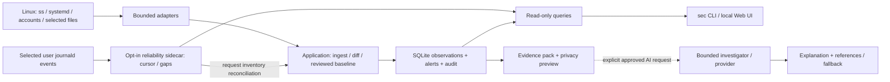

# linSec — Linux security watchdog

> Public history notice (2026-10-08): this is a separately sanitized publication copy. Private workstation, network and deployment observations were withheld throughout Git history; local paths/VM labels are publication placeholders. Original commit dates, author names, chronology and development work remain. Git email uses the owner-provided GitHub noreply address; commit hashes changed. Historical results are dated records, not new tests or current security attestations. See [publication review](docs/PUBLICATION_REVIEW.md) for evidence limitations.

**Archived engineering project · development stopped · limited operational acceptance**

linSec records security-relevant changes on a personal Linux workstation and makes
the evidence inspectable: what changed, against which reviewed baseline, how complete
the observation was, and what remains unknown. Its package and CLI retain the original
names `security-orchestrator` and `sec`.

[Русское описание](README.ru.md) · [Archive and publication review](docs/PUBLICATION_REVIEW.md)

The project combines bounded Linux adapters, SQLite history, explicit baseline
review, narrow exceptions and optional AI explanations. It was built to learn from
real workstation evidence without granting an embedded model remediation authority.
It is a portfolio prototype, not a production EDR/SIEM or a claim of complete host
protection. The owner has archived development; older roadmap and trial instructions
are historical. **No completed seven-day operational trial is claimed.**

## Implemented scope

| Component | Implementation | State at archive |
| --- | --- | --- |
| M2a watchdog | TCP/UDP IPv4/IPv6 endpoints, system/user systemd units, local accounts and selected persistence files; SQLite snapshots, baseline/diff, alert history, freshness, trust/suppression and kill switch. | Foreground runtime implemented; initial ~23h38m observed soak, incomplete operational acceptance. |
| M2b investigation | Read-only evidence packs, exact privacy preview/approval, bounded typed lookups, deterministic fallback, Ollama/OpenRouter adapters. | AI disabled by default; synthetic verification exists; real-provider/model comparison and human acceptance remain open. |
| M2c reliability and UI | Journald cursor/gap/reconciliation sidecar and authenticated read-only local Web UI sharing query operations with the CLI. | Historical acceptance: **PASS WITH KNOWN LIMITATIONS**. Frozen, not a complete journal/security telemetry platform. |
| M3 Docker adapter | One-shot preview/approved acquisition and offline capture verification by digest/schema. | Historical real capture exists; full host acceptance open. Synthetic Docker store/demo/UI were removed after review; continuous Docker monitoring was not implemented. |

## Architecture



Docker acquisition/review is a separate file-based legacy path; it is not a
permanent collector in this graph. ASCP is a separate project that reads linSec's
minimized status; its model transport and VM are not part of linSec.

**Stack:** Python 3.13, standard-library SQLite/HTTP/subprocess, Linux `ss`,
`systemctl` and `journalctl`, TOML configuration, vanilla JavaScript/HTML/CSS,
`unittest`, Ruff, uv/lockfile and a [GitHub Actions workflow](.github/workflows/checks.yml).
The package declares no runtime Python dependencies. Workflow configuration is
inspectable; this README does not claim a freshly observed remote CI run.

## Engineering decisions worth reviewing

| Decision | Code and evidence |
| --- | --- |
| A baseline is an acknowledged state, not a clean-host certificate | [Application operations](src/security_orchestrator/application.py), [snapshot ADR](docs/decisions/ADR-002-m2a-snapshots.md), [regressions](tests/test_watchdog.py). Approval binds to the reviewed diff; partial scans retain uncertainty and cannot manufacture removals. |
| Missing evidence must remain visible | [Read-only queries](src/security_orchestrator/queries.py), [reliability contract](docs/architecture/M2C-RELIABILITY.md). Stale/config-mismatched observations cannot stand in for current reconciliation; a gap is not recovered history. |
| AI gets bounded evidence access, not arbitrary tools | [Investigation service](src/security_orchestrator/investigation/service.py), [evidence builder](src/security_orchestrator/investigation/evidence.py), [ADR-003](docs/decisions/ADR-003-m2b-investigation-boundary.md). Supported operations reference only allowed evidence; no shell, arbitrary SQL/path/URL, baseline changes or alert closure. |
| Treat UI and process boundaries as security-sensitive | [Local server](src/security_orchestrator/local_ui/server.py), [hardening tests](tests/test_m2c_hardening.py), [UI threat model](docs/architecture/M2C-UI-SECURITY.md). Authentication, request boundaries, bounded reads and provenance are explicit contracts. |
| Remove complexity when its benefit is unproven | [ADR-007](docs/decisions/ADR-007-reuse-first-orchestrator.md), commit `e37377d`. Removed the synthetic-only Docker persistence/UI subsystem while retaining historical capture review and existing M2 contracts. No osquery/scanner migration is claimed. |

The [trust-boundary analysis](docs/architecture/trust-boundaries.md) also distinguishes
a private file mode, an application policy and actual isolation of a coding agent.
A process with the same user privileges can affect local evidence; host root and the
rootful Docker socket remain outside what these application checks can defend.

## Recorded results and their limits

The following evidence is historical. Raw observations and capture files are private
and ignored; public documentation provides minimized results, not independently
verifiable copies of every host observation.

| Record | Confirmed in that record | Remaining limits |
| --- | --- | --- |
| [M2a initial trial](docs/operations/M2A_TRIAL.md), September 11–12 | Foreground operation observed for 23:38:07 at the final checkpoint, stable known partial coverage and no reported storage-write failure. A real partial baseline exposed a defect fixed in `ea94746`. | Endpoint resource samples are not a benchmark; desktop lock/sleep-like behavior did not prove kernel suspend. Seven-day trial unfinished. |
| [M2c pre-acceptance hardening](docs/operations/M2C-PRE-ACCEPTANCE.md), `48a10f1` | Reproduced journal provenance/cursor, reconciliation and UI issues were corrected with targeted regressions. | Synthetic fault cases do not prove every real-host failure mode. |
| [M2c acceptance](docs/operations/M2C-ACCEPTANCE.md), September 12 | Owner-confirmed UI/service-event phases and a separate authorized host series; 196 tests recorded at documentation close. | Timer events, real-host cursor loss/rotation/reboot, fault scenarios and long soak not accepted. |
| [Reuse-first review](docs/decisions/ADR-007-reuse-first-orchestrator.md), September 13 | 237 synthetic tests, Ruff, repository hygiene, DOM checks and wheel/sdist inventory passed after subsystem removal; historical Docker captures still passed offline review. | Counts describe that commit, not current test coverage; Docker captures remained `host_validated=false`. |

The latest original code commit is `05ac126` (IPv6 interface-zone normalization).
Later documentation preparation did not rerun the full suite or activate host
monitoring. Archived September plans do not imply a running monitor today.

## AI-assisted engineering

The owner identifies linSec as developed with active AI-agent assistance. This
portfolio presents agent-assisted implementation and review honestly; it does not
attribute generated code to manual human authorship.

The retained artifacts show a concrete control process:

- **Constrained assignments:** [AGENTS.md](AGENTS.md) and the
  [development workflow](docs/operations/development.md) specify bounded increments,
  read-only defaults, synthetic verification and separate host authorization.
- **Defects drive corrections:** commit `ea94746` connects a real partial-source
  finding to baseline semantics and regressions; `48a10f1` connects pre-acceptance
  review to journal/UI fixes. These changes are inspectable, not just completion claims.
- **Human validation can reject a result:** the [M2c acceptance record](docs/operations/M2C-ACCEPTANCE.md)
  distinguishes the owner's UI/service checks from the agent's host series. It records
  the owner's rejection of an interleaved Phase D attempt and preservation of that
  evidence before a separate clean series.
- **Scope can shrink:** ADR-007 records the owner's request to reassess M2/M3 and
  the resulting removal/freeze decisions. Archiving now preserves those decisions
  instead of turning deferred experiments into claimed features.

This is evidence of task boundaries, review, correction and stop decisions. It is
not a complete agent transcript, a per-line authorship ledger, or proof of a specific
multi-agent topology. Recorded human actions, agent checks and unattributed design
choices should not be conflated.

## Safe demonstration

On Linux with Python 3.13 already installed, from a clean checkout:

```bash
PYTHONPATH=src python3.13 -B -m security_orchestrator.cli --state runtime/portfolio-demo demo
```

The standard-library-only demo creates a separate synthetic database under ignored
`runtime/portfolio-demo/synthetic-demo/`. It exercises real application operations:
reviewed synthetic baseline, new alerts, repeated observations, a narrow trust
exception, then changed executable/drop-in evidence. Output includes
`mode: synthetic_only`, `host_collection: false` and `system_changes: false`.
No collector, provider, Docker access or HTTP server is started. To repeat, choose
a new `--state` directory; existing demo data is not automatically erased.
This path was checked against committed source during portfolio preparation.

For an installed `sec` command and developer checks, prepare a project environment
with uv as described in [development](docs/operations/development.md). Existing
environments can run:

```bash
uv run --cache-dir .cache/uv --no-sync python scripts/check_m0.py
uv run --cache-dir .cache/uv --no-sync python -m unittest discover -s tests -v
uv run --cache-dir .cache/uv --no-sync ruff check --no-cache .
node tests/ui_dom_test.cjs
git diff --check
```

The local hygiene gate does not scan secrets or prove isolation. Unit tests and CI
use synthetic data; provider calls and host acceptance are separate. Historical
[monitor procedures](docs/operations/M2A-WATCHDOG.md) are retained for context,
not part of the safe demo or an instruction to restart archived development.

## Archive and publication status

The strongest evidence is the handling of uncertainty, failure and human review.
The largest gaps are incomplete operational coverage, unvalidated AI usefulness,
single-workstation assumptions and the maintenance cost of several custom subsystems.
Most detailed historical records remain in Russian; the architecture and evidence
map above provide an English entry point.

No distribution license has been selected. The
[publication review](docs/PUBLICATION_REVIEW.md) identifies workstation/network
metadata in existing documentation and Git history, plus limits of the static
credential search. No history was rewritten, runtime evidence removed, repository
published, or visibility changed during this preparation.
